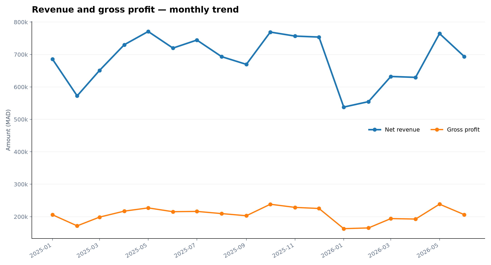
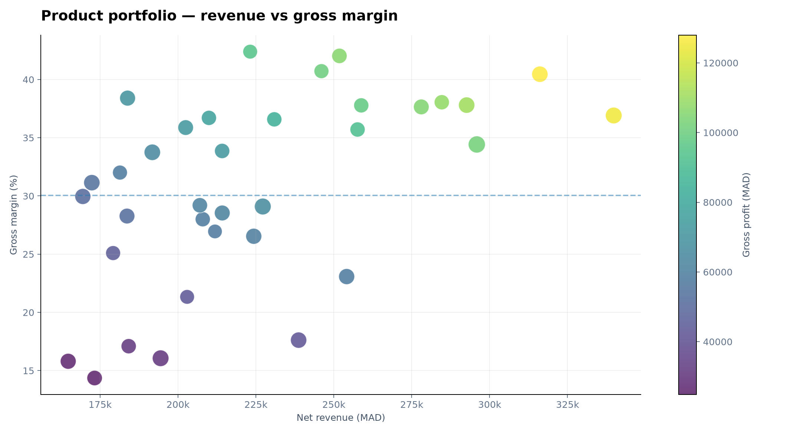
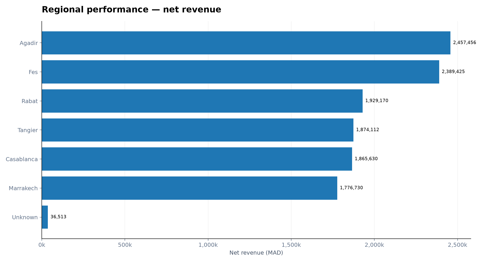
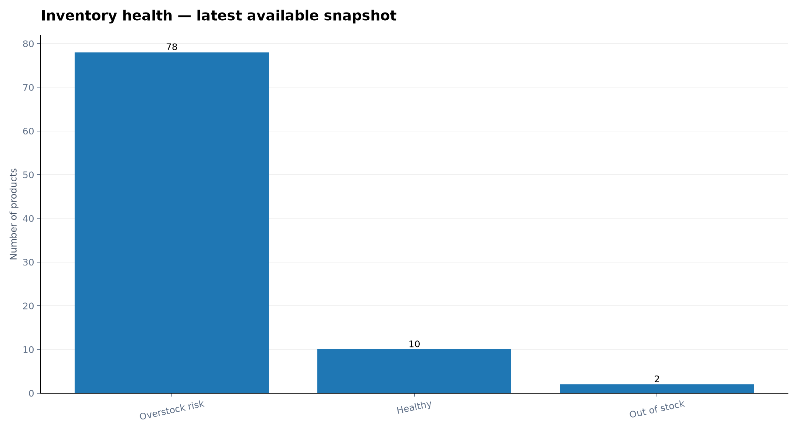
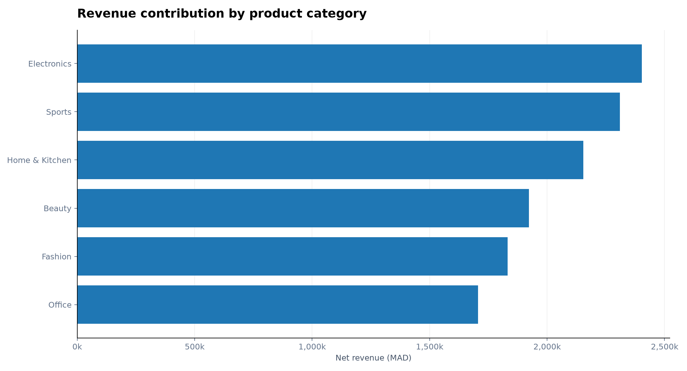

# Retail Intelligence & Supply Chain Analytics

**An end-to-end ETL pipeline for retail performance, profitability and inventory intelligence.**

## Overview

This project transforms raw retail data into structured, decision-ready insights. It analyzes sales performance, product profitability, regional revenue and inventory risks through a Python-based ETL pipeline.

*Dataset: synthetic data created for educational and analytical purposes. It does not represent a real company.*

## Architecture

```text
Excel Source Data
       │
       ▼
   EXTRACTION
  Python · Pandas
       │
       ▼
  TRANSFORMATION
 Data Cleaning · Validation
 Joins · Business Metrics
       │
       ▼
      LOADING
 Clean Tables · Fact Table
       │
       ▼
    DATA MARTS
       │
       ▼
  VISUALIZATION
 5 Analytical PNG Charts
```

## Data Sources

The Excel workbook contains six source tables and one data dictionary:

- `orders`  order details and statuses
- `order_items`  products and quantities per order
- `products`  product catalog, prices and costs
- `customers` — customer regions and segments
- `suppliers` supplier information and lead times
- `inventory_snapshots`  monthly inventory records
- `data_dictionary` field definitions and table grain

## Tech Stack

**Python · Pandas · NumPy · Matplotlib · Excel · CSV · Git**

## Visual Results

The pipeline generates five charts to explore the main business dimensions.

### 01 — Monthly Revenue & Profit

Monthly trends in net revenue and gross profit.



### 02 — Product Portfolio

Product-level performance and profitability analysis.



### 03 — Regional Performance

Comparison of sales performance across regions.



### 04 — Inventory Health

Identification of inventory risk and stock health.



### 05 — Category Mix

Revenue contribution across product categories.



## Business Insights & Decision Support

The visualizations support practical business decisions by translating analytical findings into potential actions.

| Visualization                     | What to Analyze                                                            | Recommended Business Actions                                                                                                            |
| --------------------------------- | -------------------------------------------------------------------------- | --------------------------------------------------------------------------------------------------------------------------------------- |
| **01 — Monthly Revenue & Profit** | Revenue trends, profitability changes and seasonal patterns.               | Investigate revenue declines, identify profitable periods, adjust sales targets and align purchasing plans with demand trends.          |
| **02 — Product Portfolio**        | Products generating high revenue, low margins or weak profitability.       | Prioritize high-margin products, review pricing and supplier costs, and reassess products generating revenue without sufficient profit. |
| **03 — Regional Performance**     | Differences in revenue and profitability across regions.                   | Strengthen sales strategies in high-performing regions and investigate underperforming markets through targeted commercial actions.     |
| **04 — Inventory Health**         | Products with low stock coverage, potential stockouts or excess inventory. | Prioritize replenishment for critical products, reduce unnecessary stock accumulation and review supplier lead times.                   |
| **05 — Category Mix**             | Revenue contribution and dependency on specific product categories.        | Optimize product assortment, diversify revenue sources and allocate commercial resources according to category performance.             |

### From Analysis to Action

The analytical workflow follows a decision-oriented approach:

1. **Detect** Identify unusual patterns, performance gaps and operational risks.
2. **Understand** Investigate the underlying business factors.
3. **Prioritize** Rank issues according to financial impact and operational urgency.
4. **Act** Define appropriate commercial, financial or inventory actions.
5. **Monitor** Track KPIs to evaluate the impact of decisions over time.

**Key Principle:** A visualization is not the final outcome. Its value lies in the business decision it helps support.


## Business Metrics

- **Net Revenue** = Quantity × Unit Price × (1 − Discount Rate)
- **Estimated Cost** = Quantity × Unit Cost
- **Gross Profit** = Net Revenue − Estimated Cost
- **Gross Margin** = Gross Profit / Net Revenue
- **Stock Coverage** = Available Stock / Average Daily Demand

Recognized sales include only `Delivered` orders. `Returned` and `Cancelled` orders are excluded.

## Run Locally

```bash
# Create a virtual environment
python -m venv .venv

# Activate it (Windows PowerShell)
.venv\Scripts\Activate.ps1

# Install dependencies
python -m pip install -r requirements.txt

# Run the ETL pipeline
python retail_etl_pipeline.py
```

The pipeline automatically creates the `output/` directory containing cleaned datasets, analytical data marts, a data quality report and five PNG visualizations.

## Next Steps

- Implement automated data quality tests and audit logging.
- Load the analytical model into PostgreSQL using a star schema.
- Build interactive dashboards in Power BI with DAX measures.
- Extend the pipeline with demand forecasting and predictive inventory analytics.

---

**From raw data to business intelligence. From intelligence to better decisions.**
